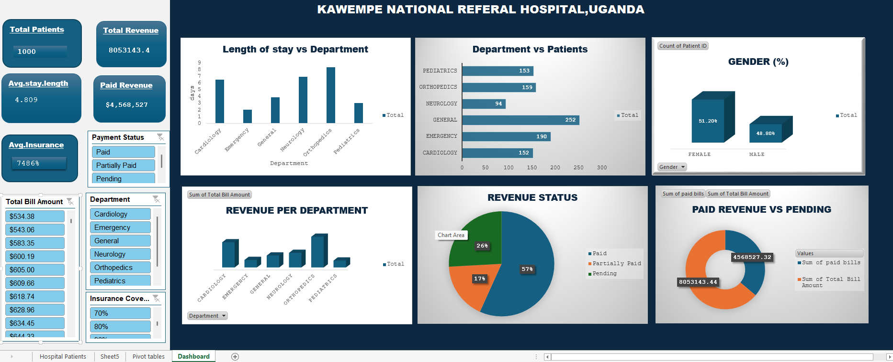

# KAWEMPE NATIONAL REFERRAL HOSPITAL PERFORMANCE DASHBOARD

## Introduction
Kawempe National Referral Hospital is a major healthcare facility serving a large and diverse patient population. To improve service quality, financial sustainability, and resource allocation, it is important to monitor patient volume, department performance, billing patterns, and payment collection trends. This project analyzes hospital patient data to produce a clear dashboard that supports better operational and financial decision-making.

The aim of this dashboard is to transform raw hospital records into meaningful insights that can guide leadership, administrators, and healthcare teams in identifying service bottlenecks, improving patient care delivery, and strengthening revenue management. The analysis helps turn data into action by highlighting where resources are most heavily used and where intervention is needed.

### Introductory Healthcare Image

## About the Dataset
The dataset used for this analysis is the hospital patient record workbook titled "Hospital_Patients_Dataset_worked1.xlsx". It contains 1,000 patient records and key variables such as:

- Patient ID and Patient Name
- Age and Gender
- Admission Date and Discharge Date
- Department
- Diagnosis
- Total Bill Amount
- Insurance Coverage %
- Payment Status
- Length of Stay (days)
- Paid Bills

This dataset gives a comprehensive view of hospital activity, covering patient demographics, service demand, treatment categories, financial performance, and payment collection status across multiple departments.

## Problem Statement
Healthcare institutions often struggle with balancing patient demand, quality of care, and financial accountability. At Kawempe National Referral Hospital, management needs a reliable way to understand:

- Which departments receive the highest patient loads
- Which departments generate the most financial demand
- How long patients stay in the hospital
- How often patients pay their bills in full or partially
- Whether insurance coverage is reducing patient out-of-pocket costs effectively
- Where operational and financial challenges exist

Without a structured dashboard, these issues can be difficult to identify quickly, resulting in poor planning, delayed payments, inefficient resource use, and weaker service delivery.

## Visualization
The following image shows the built hospital dashboard, which summarizes patient activity, department demand, bill values, and payment performance.

## Insights
From the analysis of the hospital dataset, several meaningful findings emerged:

1. Patient volume and demographics
   - The dataset contains 1,000 patient records.
   - The average patient age is approximately 46 years.
   - Female patients account for 51.2% of the dataset, while male patients represent 48.8%.

2. Department demand
   - General medicine had the highest number of patients at 252.
   - Emergency care followed with 190 patients.
   - Orthopedics recorded 159 patients.
   - Pediatrics reported 153 patients.
   - Cardiology had 152 patients.
   - Neurology had the lowest patient count at 94.

3. Financial burden and revenue generation
   - The total billed amount across all patient records is 8,053,143.44.
   - The average bill per patient is 8,053.14.
   - Orthopedics generated the highest total revenue at 2,553,862.32.
   - Cardiology followed closely at 2,095,437.97.
   - Neurology generated 1,215,302.99.

4. Payment collection status
   - 56.4% of patients paid in full.
   - 25.7% had pending bills.
   - 17.9% were partially paid.

   This indicates that while the hospital is collecting a reasonable share of revenue, there is still a significant number of pending and partially paid accounts that could affect cash flow and hospital operations.

5. Length of stay and care management
   - The average length of stay was 4.8 days.
   - This suggests that inpatient care is generally efficient, but emergency and complex cases may still require additional monitoring to reduce prolonged stays and improve bed turnover.

These insights show that the hospital is handling significant patient loads while also facing financial and operational pressures that require data-driven planning.

## Recommendation
To improve hospital performance, the following recommendations are suggested:

- Strengthen finance and billing follow-up to reduce the number of pending and partially paid cases.
- Introduce routine insurance claim tracking to improve reimbursement efficiency and reduce revenue leakage.
- Prioritize staff and equipment planning in General, Emergency, and Orthopedic departments, where patient demand and treatment costs are high.
- Monitor high-cost departments such as Orthopedics and Cardiology to ensure service sustainability and resource optimization.
- Improve discharge planning and patient follow-up to reduce unnecessary length of stay and improve bed availability.
- Use the dashboard regularly for leadership reviews, monthly performance monitoring, and strategic planning.

## Conclusion
This dashboard provides a valuable overview of patient care activities and financial performance at Kawempe National Referral Hospital. By using data to understand patient trends, department demands, and billing patterns, the hospital can make better operational decisions, improve patient satisfaction, and strengthen financial management.

The project demonstrates how healthcare analytics can support evidence-based decision-making. With continuous use of the dashboard, the hospital can improve efficiency, reduce revenue gaps, and maintain quality care for its patients.
